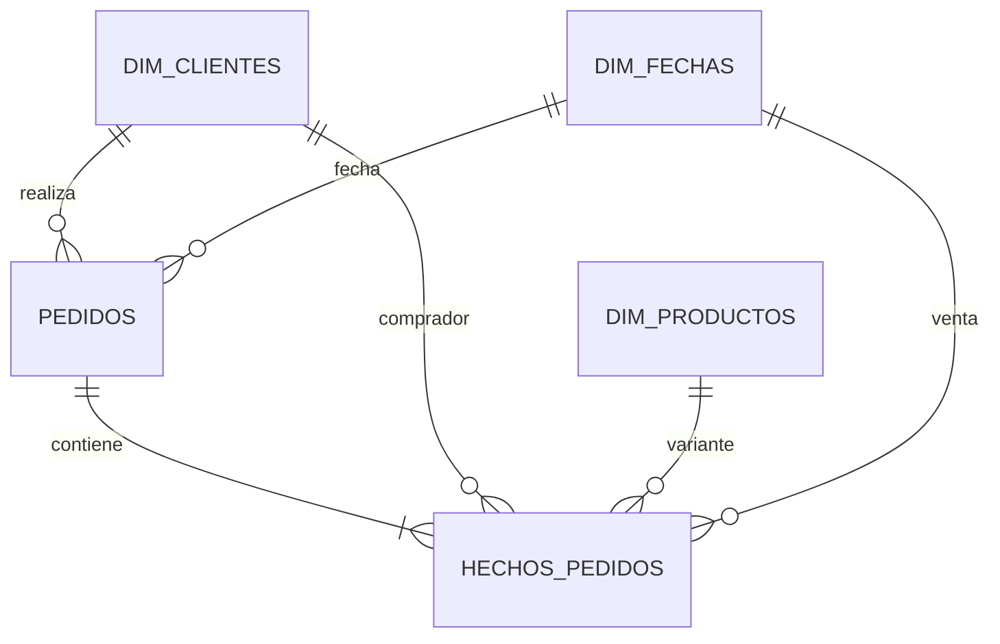

# Marca de ropa · Inventario, ventas y contabilidad

Dashboard en español construido con **Streamlit y Oracle Autonomous Database**. La conexión, los seis módulos, las transacciones y el arranque de ngrok están en un único `app.py`. Los scripts de administración y las pruebas se ejecutan por separado; abrir la página nunca borra, crea ni vuelve a sembrar tablas.

## Ejecutar

Requiere **Python 3.12 o posterior de 64 bits**, conexión a Internet y acceso a Oracle. Esta entrega incluye `.env` como plantilla sin credenciales reales. Las credenciales y el wallet se obtienen por separado del propietario por un canal privado. Cada máquina debe crear su propio entorno virtual e instalar las dependencias; no se distribuye `.venv`.

Empieza por `LEEME_PRIMERO.txt`. Antes de iniciar, completa `.env` con tus credenciales locales, coloca en `Wallet_ADBG05/` el wallet recibido del propietario por un canal privado y verifica que `WALLET_DIR` en `.env` apunte a esa carpeta. En Windows ejecuta `iniciar_windows.bat`; en macOS/Linux ejecuta `bash run.sh`. Los lanzadores crean el entorno, instalan los requisitos y arrancan la aplicación.

```bash
cd /ruta/del/proyecto
bash run.sh
```

Instalación manual en macOS/Linux:

```bash
python3 -m venv .venv
source .venv/bin/activate
python -m pip install -r requirements.txt
python app.py
```

El `.env` incluido es una plantilla y no contiene credenciales reales. Completa su configuración local antes de arrancar. Solicita al propietario las credenciales y el wallet por un canal privado y coloca el wallet en `Wallet_ADBG05/`. Si ya tienes un `.env` local configurado, consérvalo. Los equipos que se conecten a la misma base Oracle compartirán sus registros.

En Windows, la instalación manual equivalente es:

```powershell
py -3 -m venv .venv
.\.venv\Scripts\python.exe -m pip install -r requirements.txt
.\.venv\Scripts\python.exe app.py
```


El lanzador inicia Streamlit, espera su disponibilidad e imprime:

```text
Dashboard local: http://127.0.0.1:8501
Enlace para compartir: https://<dominio-asignado-por-ngrok>
```

El enlace también aparece en la barra lateral. Si otra máquina ya usa el mismo túnel y ngrok rechaza uno adicional, usa `NGROK_ENABLED=false` para abrir solo el dashboard local o detén el otro túnel. Comparte la URL y las credenciales de acceso del equipo; las claves de Oracle y el authtoken de ngrok permanecen en el servidor. Mantén el equipo conectado y el proceso en ejecución. **Ctrl+C cierra Streamlit y el túnel.** El enlace no es un despliegue permanente.

Si el puerto ya está ocupado, cierra tu instancia anterior o elige otro `STREAMLIT_PORT`. No arranques simultáneamente el lanzador y otra instancia de Streamlit en el mismo puerto. Para depurar solo la UI: `python -m streamlit run app.py -- --ui`.

## Configuración exclusiva en .env

La aplicación usa `dotenv_values(..., interpolate=False)`. No lee credenciales desde variables del shell ni desde `secrets.toml`. Las rutas relativas se resuelven contra el directorio de `app.py`, independientemente de dónde ejecutes el comando.

| Variable | Significado |
| --- | --- |
| `USER_DB` | Usuario Oracle. |
| `DB_PASSWORD` | Contraseña del usuario Oracle. |
| `DB_DSN` | Alias de `tnsnames.ora` o descriptor de conexión. |
| `DB_SCHEMA` | Propietario de las tablas; este proyecto usa `EMILIO_CRUZ10`. |
| `WALLET_DIR` | Carpeta del wallet; en thin debe contener `tnsnames.ora` y `ewallet.pem`. |
| `WALLET_KEY` | Contraseña del wallet, distinta de la del usuario. |
| `ORACLE_MODE` | `thin` por defecto; `thick` requiere Instant Client. |
| `ORACLE_CLIENT_LIB_DIR` | Ruta del cliente cuando se utiliza thick. |
| `STREAMLIT_PORT` | Puerto local, `8501` por defecto. |
| `NGROK_ENABLED` | `true` para compartir, `false` para uso exclusivamente local. |
| `NGROK_AUTHTOKEN` | Token proporcionado por tu cuenta ngrok. |
| `NGROK_BASIC_USER` | Usuario de acceso que eliges para tu equipo. |
| `NGROK_BASIC_PASSWORD` | Contraseña compartida elegida por ti, entre 8 y 128 caracteres. |
| `MAX_ROWS` | Límite de filas visibles/exportadas en listados y consola; 20.000 por defecto. |
| `QUERY_TIMEOUT_SECONDS` | Límite de cada llamada Oracle; 30 segundos por defecto. |
| `CONNECT_TIMEOUT_SECONDS` | Timeout de conexión; 10 segundos por defecto. |
| `POOL_WAIT_TIMEOUT_SECONDS` | Espera para adquirir conexión; 30 segundos por defecto. |
| `POOL_MAX_CONNECTIONS` | Máximo del pool; 4 por defecto. |

Entrecomilla los valores que contengan espacios o `#`. Las contraseñas conservan su contenido literal, sin interpolar `${...}`. Para la autenticación ngrok, la secuencia `${` está reservada por sus políticas y se rechaza; el usuario tampoco admite `:`. Usa una contraseña compartida distinta de las claves de tus cuentas.

Los certificados y claves del wallet son archivos y permanecen en su carpeta; `.env` contiene su ruta y contraseña. Esta entrega incluye un `.env` de plantilla sin credenciales reales y no incluye el wallet. Completa las credenciales en tu copia local.

Reinicia `python app.py` al cambiar el puerto, ngrok o las credenciales. El modo thin no necesita instalar Instant Client.

## Compartir con ngrok

Se utiliza el SDK oficial `ngrok`, con un único túnel propiedad del lanzador. Las recargas y nuevas pestañas de Streamlit no crean túneles adicionales. El acceso HTTPS exige **HTTP Basic Auth**, mediante una Traffic Policy construida en memoria. Todas las personas autenticadas tienen acceso a los seis módulos.

Si falta el token, el usuario o la contraseña, o ngrok rechaza la conexión, la aplicación explica el problema y funciona solo en localhost. Nunca se reintenta eliminando la autenticación. CORS y XSRF permanecen activados.

El token y la contraseña no se pasan como argumentos a procesos ni se guardan en una política JSON/YAML. El subproceso solo recibe la URL pública. Se conserva el enlace exacto que devuelve ngrok; su disponibilidad y límites dependen de tu cuenta.

Documentación: [SDK Python de ngrok](https://ngrok.github.io/ngrok-python/) y [Basic Auth](https://ngrok.com/docs/gateway/traffic-policy/actions/basic-auth).

## Los seis módulos

1. **Resumen y contabilidad:** selector mensual o rango inclusivo; facturación, costo vendido, utilidad, margen, pedidos y unidades; evolución por mes y diez diseños más vendidos por unidades.
2. **Clientes:** registrar nombre, correo, teléfono y dirección; consultar por nombre/correo y estado.
3. **Productos e inventario:** registrar categoría, talla, color, precio, costo y existencias iniciales; filtrar por categoría, talla, color y disponibilidad.
4. **Crear pedido:** seleccionar cliente activo y fecha, agregar varias prendas, acumular cantidades repetidas y confirmar.
5. **Consultar pedidos:** buscar por cliente y fechas; revisar líneas y valores históricos.
6. **Laboratorio SQL:** SELECT/WITH, JOIN, agregaciones y parámetros JSON (`:id_cliente`); ejemplos y diccionario de datos. DML, DDL, múltiples sentencias, secuencias, enlaces remotos y llamadas a funciones de usuario/paquetes no están permitidos.

Las tablas y reportes se pueden exportar a CSV. Cuando un listado alcanza `MAX_ROWS`, la página lo indica y exporta únicamente las filas cargadas. **Los indicadores contables agregan todos los registros en Oracle**, sin aplicar ese límite. Los meses sin ventas muestran cero.

La facturación se define como la suma de cantidades por precios históricos; el costo vendido usa los costos históricos; utilidad = facturación − costo; margen = utilidad / facturación × 100, con cero si no hay facturación. La clasificación de más vendidos agrupa las tallas de un mismo nombre de diseño. Esta entrega no incluye impuestos, gastos, pagos, devoluciones ni facturación electrónica.

## Modelo de Oracle



- `DIM_CLIENTES`: PK identity; correo normalizado único; datos esenciales obligatorios; estado ACTIVO/INACTIVO.
- `DIM_PRODUCTOS`: una fila por variante. Categorías `Pantalon`, `camisa`, `camiseta`, `pantaloneta`, `accesorio`, `top`; tallas XS/S/M/L/XL. Variante única por nombre/categoría/talla/color normalizados. Stock entero no negativo; importes `NUMBER(12,2)` no negativos.
- `DIM_FECHAS`: fecha única a medianoche; ID YYYYMMDD y día/mes/anio derivados mediante columnas virtuales.
- `PEDIDOS`: PK identity, cliente, fecha y UUID único de operación; no duplica los totales de las líneas.
- `HECHOS_PEDIDOS`: cantidad entera positiva, precio/costo históricos y total virtual. FKs directas a dimensiones más FK compuesta `(numero_pedido,id_cliente,id_fecha)` a cabecera. Unicidad por pedido/producto y sin borrado en cascada.

Un pedido se guarda en una transacción: valida cliente, crea cabecera, bloquea variantes por ID ascendente, verifica inventario actual, guarda snapshots y descuenta stock. Si una línea falla, se revierte todo. Un UUID de operación evita duplicar pedidos al reintentar. Ante un resultado incierto, la UI conserva el intento y permite verificar/reintentar la misma operación antes de modificar el carrito.

El sistema admite utilidad negativa; cambiar precios o costos del catálogo no recalcula ventas anteriores. La UI no ofrece edición ni eliminación de ventas confirmadas.

## Instalación y administración de la base

La migración inicial fue realizada el **5 de noviembre de 2026**. Se respaldaron las seis tablas universitarias antes de eliminarlas; el usuario y wallet se conservaron.

El respaldo universitario permanece en la máquina original y no forma parte de este paquete. No es necesario para usar la aplicación de ropa.

Scripts:

- `sql/00_limpiar_kardex.sql`: limpieza explícita de las tablas antiguas, guardando usuario/esquema esperado.
- `sql/01_crear_modelo.sql`: cinco tablas, restricciones e índices.
- `sql/02_datos_ejemplo.sql`: carga transaccional reproducible, solo sobre tablas vacías.
- `sql/03_verificar.sql`: consultas de conteos, integridad y resultados.

Herramienta de administración, independiente de la aplicación:

```bash
python tools/admin_oracle.py preflight
python tools/admin_oracle.py backup
python tools/admin_oracle.py verify
```

Para una instalación nueva que todavía tenga el esquema universitario, después de revisar el preflight y crear el respaldo:

```bash
python tools/admin_oracle.py migrate --backup-dir backups/<respaldo-verificado>
```

**La base actual ya está migrada. No repitas la migración.** La herramienta se detiene si encuentra tablas nuevas, objetos ajenos o dependencias fuera de la lista acordada. Antes del primer DROP compara el respaldo contra la estructura y los datos actuales. El DDL de Oracle confirma implícitamente sus cambios; no se revierte con ROLLBACK.

Existe `restore --backup-dir ...` para recuperación explícita, con guardas que impiden sobrescribir tablas existentes. No se ejecuta automáticamente ni forma parte del arranque. Este paquete contiene exclusivamente la aplicación de ropa, sus utilidades y sus pruebas; `app.py` no depende del proyecto universitario.

## Datos iniciales verificados

| Concepto | Cantidad |
| --- | ---: |
| Clientes ficticios | 20 |
| Diseños / variantes | 30 / 150 |
| Pedidos / líneas | 60 / 150 |
| Unidades vendidas | 300 |
| Inventario disponible | 1.813 |
| Variantes agotadas | 8 |
| Facturación | $24.267.000 COP |
| Costo vendido | $10.815.000 COP |
| Utilidad bruta | $13.452.000 COP |

Los 60 pedidos cubren junio a noviembre de 2026, diez por mes. La semilla calcula sus seis meses respecto al día de ejecución en Colombia. Todos los clientes usan correos `example.com` y datos ficticios. Estos conteos cambiarán cuando registres datos nuevos.

## Pruebas

Pruebas locales de configuración, SQL, transacciones simuladas, reportes, UI y lanzador:

```bash
python -m unittest discover -s tests -v
```

Pruebas de integración contra Oracle, expresamente activadas:

```bash
python tests/test_oracle_integration.py --oracle
```

Para comprobar el enlace ngrok activo (HTTP, autenticación y dos sesiones WebSocket), sin modificar datos:

```bash
python tests/test_ngrok_integration.py --url https://<tu-enlace-ngrok>
```

La prueba lee las credenciales de `.env`; sin `--url` no accede a la red.

Estas pruebas crean clientes/productos propios identificados como TEST_, comprueban constraints, snapshots, rollback, concurrencia e idempotencia, y eliminan únicamente sus fixtures. No modifican las ventas de muestra. Sin `--oracle`, no se establece conexión y las pruebas de integración se omiten.

La comprobación del endpoint de salud de Streamlit solo confirma que el servidor está disponible. La validación de Oracle, navegación y WebSocket se hace por separado.

## Diagnóstico

- **ORA-12514 / DPY-6001:** el listener no reconoce el servicio. Verifica que Autonomous esté Available y compara el servicio actual con el wallet.
- **DPY-4005:** usa «Conexión y configuración → Probar conexión» para distinguir errores del servicio y espera del pool.
- **Faltan tablas:** ejecuta la verificación administrativa; abrir Streamlit no crea tablas automáticamente.
- **Ngrok no está disponible:** comprueba token, credenciales de acceso y conexión; el dashboard local sigue disponible.
- **Pedido pendiente de verificación:** reintenta desde el bloque dedicado; conserva el mismo token para recuperar un COMMIT cuya respuesta se haya perdido.
